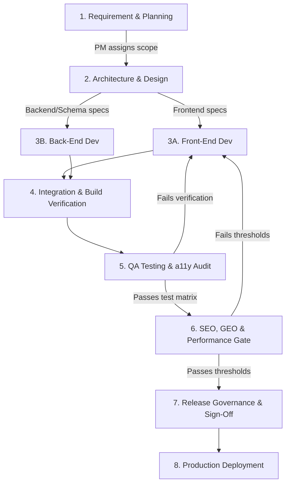

# Standard Operating Procedure: End-to-End Engineering Pipeline

**Document ID**: SOP-PIPE-001  
**Project**: Nexera Smart Web Application  
**Version**: 1.0.0  
**Effective Date**: 2026-10-12  

---

## 1. Purpose & Scope
This SOP defines the complete lifecycle pipeline for developing, auditing, testing, and deploying changes to the Nexera Smart web application. All autonomous subagents and team members must execute tasks through this structured sequential pipeline.

---

## 2. Pipeline Architecture & Workflow

---

## 3. Pipeline Phases & Responsible Agents

### Phase 1: Planning & Scope Definition
* **Owner**: `project-manager`
* **Input**: User feature request, performance bug, or commercial enhancement.
* **Output**: User story with clear Acceptance Criteria (AC), affected routes, and assigned subagents.
* **Gate Check (Definition of Ready)**:
  * Business objective defined.
  * Technical prerequisites identified (e.g. Supabase migration needed vs UI-only change).

### Phase 2: Architectural Design
* **Owner**: `project-manager` + `frontend-developer` / `backend-developer`
* **Deliverable**: Component interface contracts, database migration scripts, or routing plan.

### Phase 3: Implementation
* **Phase 3A (Front-End)**: `frontend-developer`
  * Implements UI adhering to [SOP_FRONTEND.md](./SOP_FRONTEND.md) and [SOP_PERFORMANCE.md](./SOP_PERFORMANCE.md).
  * Executes route code splitting, accessibility ARIA markup, and responsive layouts.
* **Phase 3B (Back-End)**: `backend-developer`
  * Authors PostgreSQL migrations adhering to [SOP_BACKEND.md](./SOP_BACKEND.md) and [SOP_SECURITY.md](./SOP_SECURITY.md).
  * Verifies RLS policies, storage bucket quotas, and client SDK integration.

### Phase 4: Integration & Build Gate
* **Automated Checks**:
  1. `npm run typecheck` — 0 errors.
  2. `npm run lint` — 0 errors.
  3. `npm run build` — 0 errors, no monolithic chunks > 500 kB.

### Phase 5: QA Testing & Accessibility Audit
* **Owner**: `qa-engineer`
* **Execution**: Adheres to [SOP_QA_TESTING.md](./SOP_QA_TESTING.md).
* **Checks**:
  * Form validation, error states, and database submission verification.
  * Cross-device responsive test (Mobile: 375px/390px, Tablet: 768px, Desktop: 1440px).
  * Keyboard navigation and contrast ratio checks.

### Phase 6: SEO, GEO & Performance Gate
* **Owner**: `seo-geo-specialist`
* **Execution**: Adheres to [SOP_SEO_GEO.md](./SOP_SEO_GEO.md) and [SOP_PERFORMANCE.md](./SOP_PERFORMANCE.md).
* **Checks**:
  * JSON-LD Structured Data verified via schema validator.
  * Local Dubai/UAE meta tags intact.
  * Internal linking verified; zero orphaned pages.
  * LCP < 2.2s, CLS < 0.05, INP < 200ms.

### Phase 7: Release Governance & Deployment
* **Owner**: `project-manager`
* **Check (Definition of Done)**:
  * All previous phases signed off.
  * Zero regression in core user flows.
  * Deployment logs verified.

---

## 4. Emergency & Rollback Procedure
If a production issue or blocking bug is detected:
1. `project-manager` halts the release and logs the root cause.
2. `qa-engineer` isolates the failing commit or route.
3. Subagent implements hotfix under expedited pipeline with mandatory QA sign-off.
